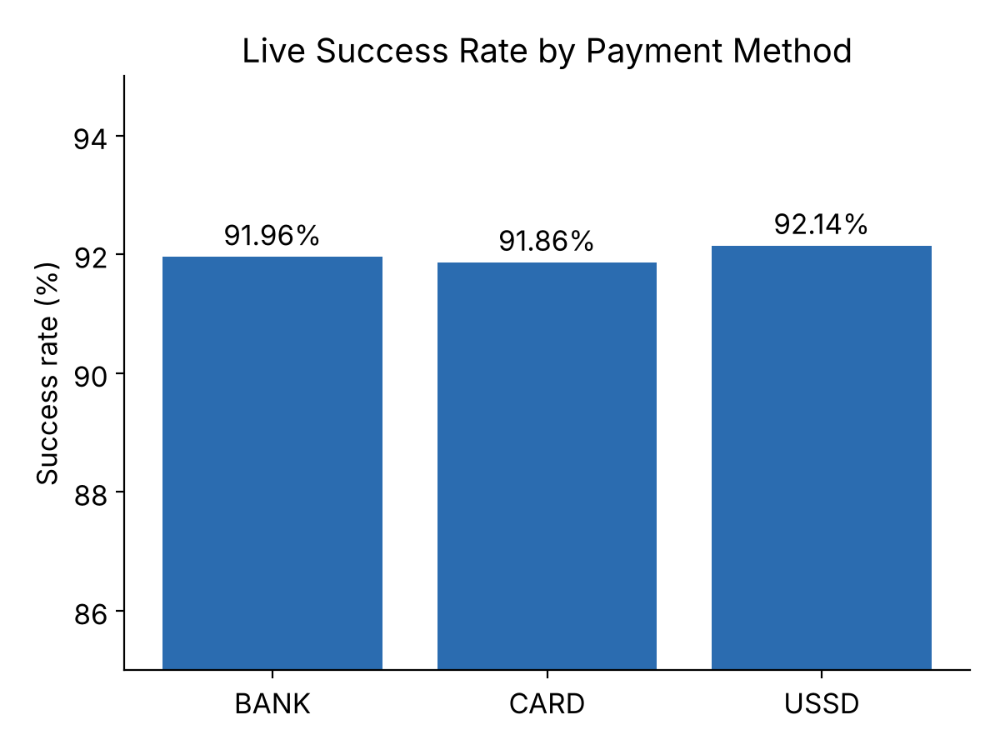
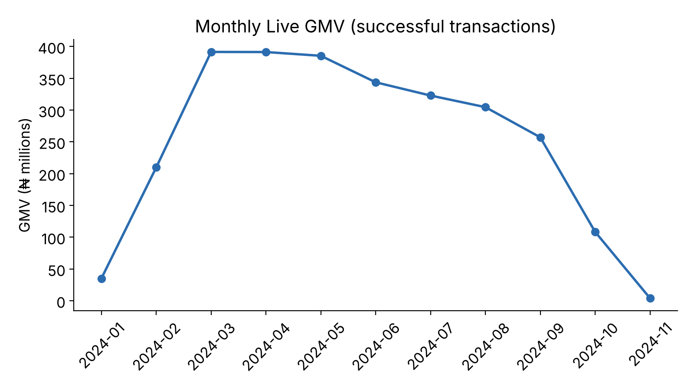
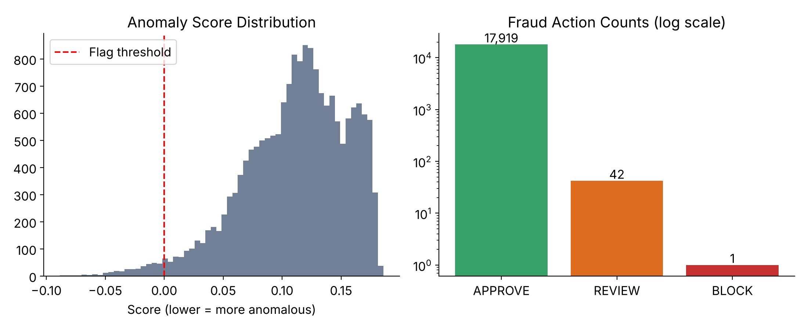
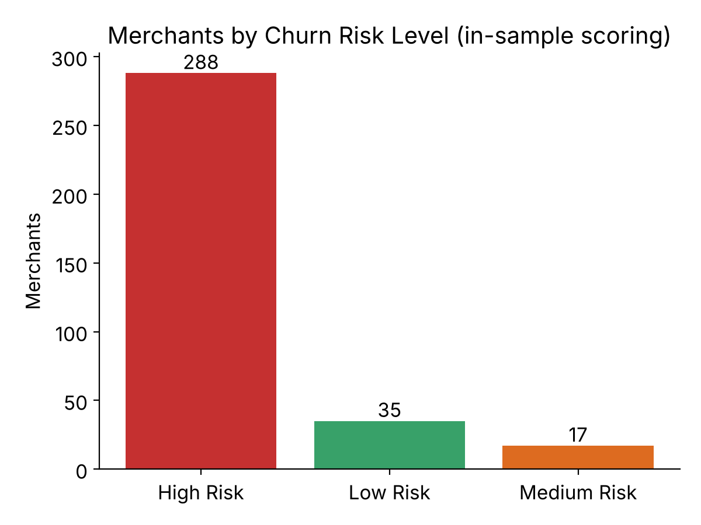
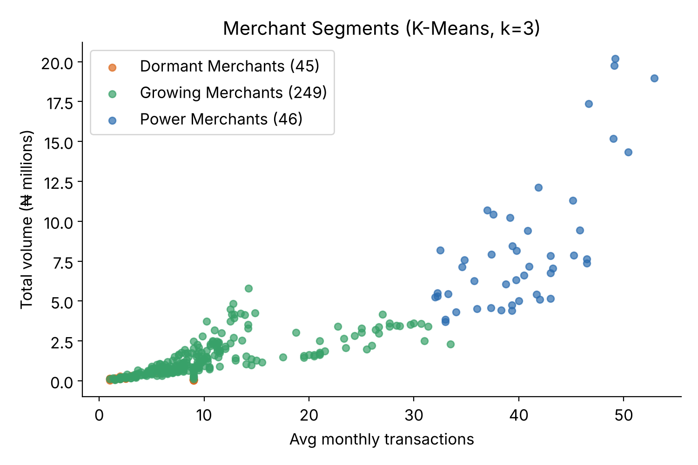

# Merchant Payment Product Intelligence


**End-to-End Fintech Product Analytics | SQL | Python | Machine Learning | Power BI**

An end-to-end fintech product analytics project simulating a Paystack-style payment platform. It explores merchant onboarding, payment performance, engagement, retention, transaction anomalies, and merchant segmentation through SQL analytics, Python, machine learning, and interactive Power BI reporting.

The goal is to demonstrate how data analytics and machine learning can transform transactional data into meaningful business insights and support data-driven product decisions.

> **Data Disclaimer:** All datasets in this project are synthetic and generated programmatically. No real merchant, customer, or payment information is used. Findings represent simulated business behaviour, not the performance of an actual payment company.

---

## Table of Contents

- [Project Overview](#project-overview)
- [Business Objectives](#business-objectives)
- [Dataset Overview](#dataset-overview)
- [Technology Stack](#technology-stack)
- [Project Architecture](#project-architecture)
- [SQL Analytics](#sql-analytics)
- [Machine Learning](#machine-learning)
- [Key Results](#key-results)
- [Power BI Reporting](#power-bi-reporting)
- [Project Structure](#project-structure)
- [Getting Started](#getting-started)
- [Limitations](#limitations)
- [Future Improvements](#future-improvements)
- [License](#license)
- [Power BI Dashboard](#power-bi-dashboard)

---

## Project Overview

Payment platforms generate large volumes of transaction and merchant activity data. Understanding these datasets is essential for improving payment performance, merchant activation, engagement, and retention.

This project builds a simulated fintech analytics environment covering the merchant lifecycle and payment ecosystem.

It combines:

- Relational database design and SQL analytics.
- Merchant onboarding and activation analysis.
- Payment performance and transaction trends.
- Merchant engagement and retention analysis.
- Merchant churn prediction.
- Transaction anomaly detection.
- Merchant segmentation using clustering.
- Interactive business intelligence reporting.

## Business Objectives

The project addresses six major business questions:

| Business Area | Business Question |
|---|---|
| Merchant Onboarding | How many registered merchants successfully process their first live payment? |
| Merchant Engagement | How actively are merchants using the platform? |
| Payment Performance | Which payment methods and transaction categories perform best? |
| Merchant Retention | Which merchants exhibit characteristics associated with churn? |
| Transaction Risk | Which transactions demonstrate unusual behavioural patterns? |
| Merchant Segmentation | Which merchant groups contribute most to transaction volume? |

## Dataset Overview

The project uses synthetic datasets generated through `python_scripts/Data_Ingestion.py`.

### Raw Datasets

| Dataset | Records | Description |
|---|---:|---|
| Merchants | 800 | Merchant registration and business information |
| Transactions | 78,810 | Payment transaction records |
| API Keys | 1,149 | Merchant API key information |
| Merchant Onboarding | 800 | Merchant activation and onboarding milestones |

### Processed Datasets

| Dataset | Records | Purpose |
|---|---:|---|
| Churn Model | 340 | Merchant-level churn modelling features |
| Fraud Model | 17,962 | Transaction-level anomaly detection features |
| Merchant Segmentation | 340 | Merchant behavioural segmentation features |

### Transaction Overview

| Metric | Value |
|---|---:|
| Total Transactions | 78,810 |
| Live Transactions | 73,192 |
| Test Transactions | 5,618 |
| Live Transaction Success Rate | 91.99% |
| Currency | NGN |
| Data Period | 3 January 2024 – 13 November 2024 |
| Successful Live GMV | Approximately ₦2.75 billion |

**GMV (Gross Merchandise Value)** represents the value of successfully processed live transactions. It is not the payment platform's revenue.

---

## Technology Stack

| Category | Technologies |
|---|---|
| Programming | Python |
| Database | Microsoft SQL Server |
| Data Analysis | Pandas, NumPy |
| Machine Learning | Scikit-learn |
| Data Visualization | Matplotlib, Seaborn |
| Business Intelligence | Microsoft Power BI |
| Development Environment | Visual Studio Code, Jupyter Notebook |
| Database Tools | SQL Server-compatible SQL client |
| Version Control | Git, GitHub |

---

## Project Architecture

The project follows an end-to-end analytics workflow.

```text
              SYNTHETIC DATA GENERATION
                       Python
                         |
                         v
                  RAW CSV DATASETS
                         |
                         v
                RELATIONAL DATABASE
                  Microsoft SQL Server
                         |
                         v
                    SQL ANALYTICS
                         |
          +--------------+--------------+
          |              |              |
          v              v              v
      Onboarding     Engagement      Retention
          |              |              |
          +--------------+--------------+
                         |
                         v
                  PYTHON ANALYTICS
                         |
          +--------------+--------------+
          |              |              |
          v              v              v
     Churn Model    Anomaly Model   Segmentation
          |              |              |
          +--------------+--------------+
                         |
                         v
                RESULTS & INSIGHTS
                         |
                         v
                   POWER BI
              INTERACTIVE DASHBOARD
```

### Database Design

The database is organised around three core entities:

- `merchants`
- `api_keys`
- `transactions`

Additional analytical views support merchant onboarding, activity, and lifecycle analysis.


---

## SQL Analytics

SQL is used to investigate merchant behaviour, payment performance, and product engagement.

### 1. Merchant Onboarding

- Total registered merchants.
- Activated merchants.
- Merchant activation rate.
- Time from registration to first successful live transaction.
- Merchant activation funnel.
- Activation by business type.

**Activation Definition:** A merchant is considered activated after completing at least one successful LIVE transaction.

### 2. Payment Performance

- Transaction success and failure rates.
- Payment method distribution.
- Payment failure reasons.
- Monthly transaction trends.
- Monthly successful live GMV.
- Average transaction amount.

### 3. Merchant Engagement

- Monthly Active Merchants (MAM).
- Merchant transaction frequency.
- Merchant engagement levels.
- Merchant activity trends.

### 4. Retention and Churn Analytics

- Monthly merchant churn.
- M1 and M3 cohort retention.
- D30, D60, and D90 retention.
- Merchant lifecycle classification.
- Pre-churn transaction behaviour.

### 5. Payment Volume Analysis

- Monthly GMV.
- Payment volume by merchant segment.
- Transaction volume trends.
- Revenue-related analysis using transaction values.

> Transaction value is not equivalent to platform revenue. Actual processing fees and operating costs are not included in the synthetic datasets.

SQL files:

- `sql_scripts/Tables.sql` — database schema and analytical views.
- `sql_scripts/Analytics.sql` — business and product analytics queries.

---

## Machine Learning

Three machine learning workflows explore merchant and transaction behaviour.

### 1. Merchant Churn Prediction

**Algorithm:** Random Forest Classifier

**Objective:** Estimate merchant churn risk using historical merchant activity and transaction behaviour.

Features include:

- Total transactions.
- Total transaction volume.
- Average transaction amount.
- Successful transaction rate.
- Failure rate.
- Days since last transaction.
- Recent transaction activity.
- Merchant age.
- Payment method diversity.

#### Model Evaluation

Held-out test set: 102 merchants.

| Metric | Result |
|---|---:|
| Accuracy | 85.29% |
| Balanced Accuracy | 82.93% |
| Precision | 97.53% |
| Recall | 85.87% |
| F1 Score | 91.33% |
| ROC-AUC | 94.57% |
| PR-AUC | 99.41% |

These are results from the project's held-out test set. The model still requires further validation for real-world or future-period prediction.

### 2. Transaction Anomaly Detection

**Algorithm:** Isolation Forest

**Objective:** Identify transactions with unusual behavioural patterns for further investigation.

Features include:

- Transaction amount.
- Merchant average transaction amount.
- Transaction timing.
- Merchant transaction history.
- Merchant failure rate.
- Rapid repeat transactions.
- Transaction burst patterns.
- Merchant lifecycle information.

The workflow identifies unusual transactions and produces risk-oriented outputs for analysis.

**Important:** Model-flagged anomalies are not confirmed fraudulent transactions. They are potential anomalies that would require additional investigation.

### 3. Merchant Segmentation

**Algorithm:** K-Means Clustering

**Objective:** Group merchants according to transaction behaviour and business activity.

Features include:

- Total transaction volume.
- Average transaction size.
- Transaction frequency.
- Average monthly transactions.
- Payment method diversity.
- Transaction success rate.
- Merchant age.

The workflow applies feature standardisation before clustering and uses transaction volume to assign interpretable segment labels.

The three resulting groups represent:

- Low-Volume Merchants
- Mid-Volume Merchants
- High-Volume Merchants

---

## Key Results

The project produces several analytical outputs:

| Area | Output |
|---|---|
| Merchant Onboarding | Activation metrics and onboarding funnel |
| Payment Analytics | Success rate, failure analysis, and GMV trends |
| Engagement | Monthly active merchant and engagement analysis |
| Retention | Cohort retention and merchant churn analysis |
| Churn Prediction | Merchant churn probabilities and risk categories |
| Anomaly Detection | Model-flagged transaction anomalies |
| Segmentation | Merchant clusters and segment-level metrics |

### Selected Visualizations

**Payment Performance**



**Monthly GMV**



**Transaction Anomaly Detection**



**Merchant Churn Analysis**



**Merchant Segmentation**



---

## Power BI Reporting

An interactive Power BI dashboard brings the analytical outputs together into a business-focused reporting experience.

The dashboard includes:

- Total merchants.
- Total transaction volume.
- Total transactions.
- Average transaction value.
- Average merchant churn probability.
- Model-flagged anomalies.
- Monthly transaction volume.
- Transactions by payment status.
- Transaction volume by payment status.
- Merchant distribution by segment.
- Merchant distribution by churn risk.
- Top merchants by transaction volume.
- Model-flagged anomalies by day of the week.

The dashboard is designed to provide an executive-level overview of merchant activity, payment performance, and transaction risk.

---

## Project Structure

```text
Merchant-Payment-Product-Intelligence/
│
├── data/
│   ├── raw/
│   │   ├── merchants.csv
│   │   ├── api keys.csv
│   │   ├── transactions.csv
│   │   └── merchant onboarding.csv
│   │
│   └── processed/
│       ├── Churn model.csv
│       ├── Fraud Model.csv
│       └── Merchant Segmentation.csv
│
├── images/
│   ├── Neon Merchant Intelligence Dashboard Animation.gif
│   ├── dashboard.png
│   ├── db_erd.png
│   └── result_*.png
│
├── notebooks/
│   ├── Data_Ingestion.ipynb
│   ├── Churn_Prediction.ipynb
│   ├── Fraud_Detection.ipynb
│   └── Merchant_Segmentation.ipynb
│
├── powerbi_dashboard/
│   ├── Merchant-Payment-Product-Intelligence-Dashboard.pbix
│   └── dashboard.png
│
├── python_scripts/
│   ├── Data_Ingestion.py
│   ├── Churn_Prediction.py
│   ├── Fraud_Detection.py
│   └── Merchant_Segmentation.py
│
├── results/
│   ├── churn_feature_importance.csv
│   ├── churn_model_metrics.csv
│   ├── churn_predictions_with_risk.csv
│   ├── churn_test_predictions.csv
│   ├── fraud_alert.csv
│   ├── high_risk_transactions.csv
│   └── merchants_with_segments.csv
│
├── sql_scripts/
│   ├── Tables.sql
│   └── Analytics.sql
│
├── LICENSE
└── README.md
```

---

## Getting Started

### Prerequisites

- Python 3.10 or later.
- Microsoft SQL Server.
- Visual Studio Code or Jupyter Notebook.
- Git.

### 1. Clone the Repository

```bash
git clone <YOUR_GITHUB_REPOSITORY_URL>
cd Merchant-Payment-Product-Intelligence
```

### 2. Install Python Dependencies

```bash
pip install pandas numpy scikit-learn matplotlib seaborn
```

### 3. Generate Synthetic Data

```bash
python python_scripts/Data_Ingestion.py
```

This generates the raw merchant, API key, and transaction datasets.

### 4. Set Up the Database

Execute:

```text
sql_scripts/Tables.sql
```

This creates the database schema and analytical views.

Import the generated CSV datasets into their corresponding database tables.

### 5. Execute SQL Analytics

Run the queries in:

```text
sql_scripts/Analytics.sql
```

### 6. Run the Machine Learning Scripts

```bash
python python_scripts/Churn_Prediction.py

python python_scripts/Fraud_Detection.py

python python_scripts/Merchant_Segmentation.py
```

The scripts generate analytical outputs and model results in the project directories.

### 7. Open the Power BI Dashboard

Open:

```text
powerbi_dashboard/Merchant-Payment-Product-Intelligence-Dashboard.pbix
```

Use Power BI Desktop to explore the interactive report. Update data-source paths if necessary when opening the project on another computer.

---

## Limitations

- All data is synthetic and does not represent a real payment platform.
- Synthetic transaction patterns may not reflect real-world payment behaviour.
- Churn model results require further validation using a properly time-separated evaluation strategy.
- The churn dataset contains a limited number of merchant records.
- Isolation Forest identifies unusual observations, not confirmed fraud.
- The anomaly contamination setting is a modelling parameter, not an estimate of the real fraud rate.
- Transaction volume and GMV should not be interpreted as platform revenue.
- The Power BI report depends on the imported datasets and their relationships.

---

## Future Improvements

- Develop time-based churn prediction and validation.
- Improve merchant activation and retention cohort analysis.
- Add merchant lifetime value modelling.
- Introduce SHAP-based model explainability.
- Improve anomaly detection with additional behavioural features.
- Add automated data quality checks.
- Build a reproducible end-to-end data pipeline.
- Extend the Power BI report with more detailed product and operational metrics.

---

## License

This project is licensed under the MIT License. See the [LICENSE](LICENSE) file for details.

---

## Power BI Dashboard


**Interactive Dashboard:**  
The Power BI report file is available at:

`powerbi_dashboard/Merchant-Payment-Product-Intelligence-Dashboard.pbix`


---

## Developed By

** SREERAG **  
BCA Data Science Graduate

[LinkedIn](https://www.linkedin.com/in/sreerag-s-9b25162a7/) •
[GitHub](https://github.com/sreeragsrinu) •
[Portfolio](https://sreeragportfolio.netlify.app) •
[Email](sreeragsrinuu@gmail.com)