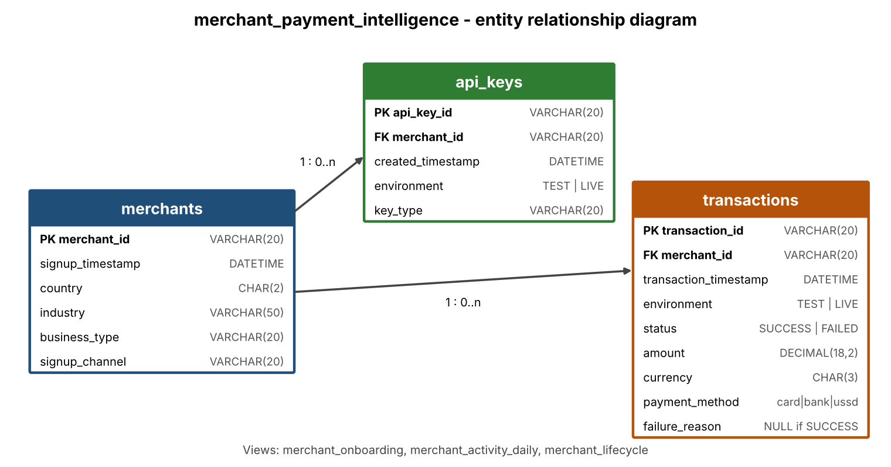
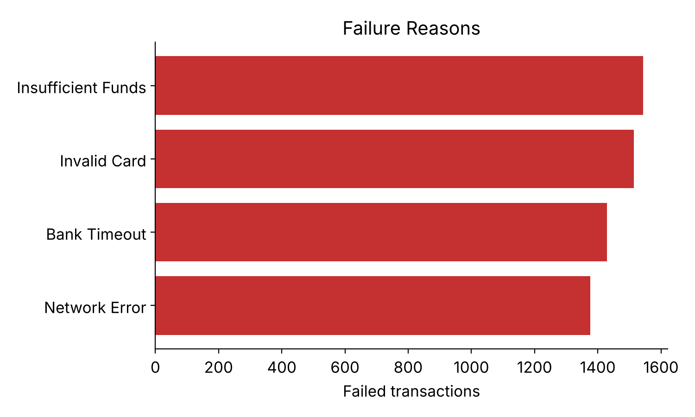
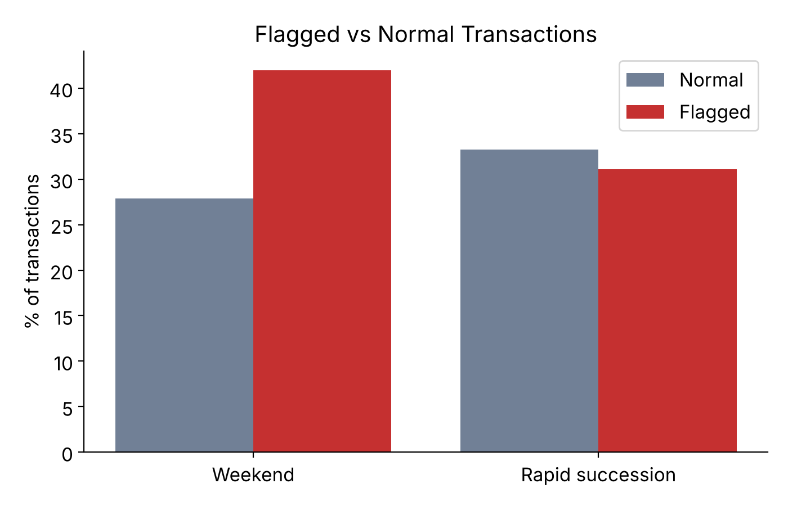
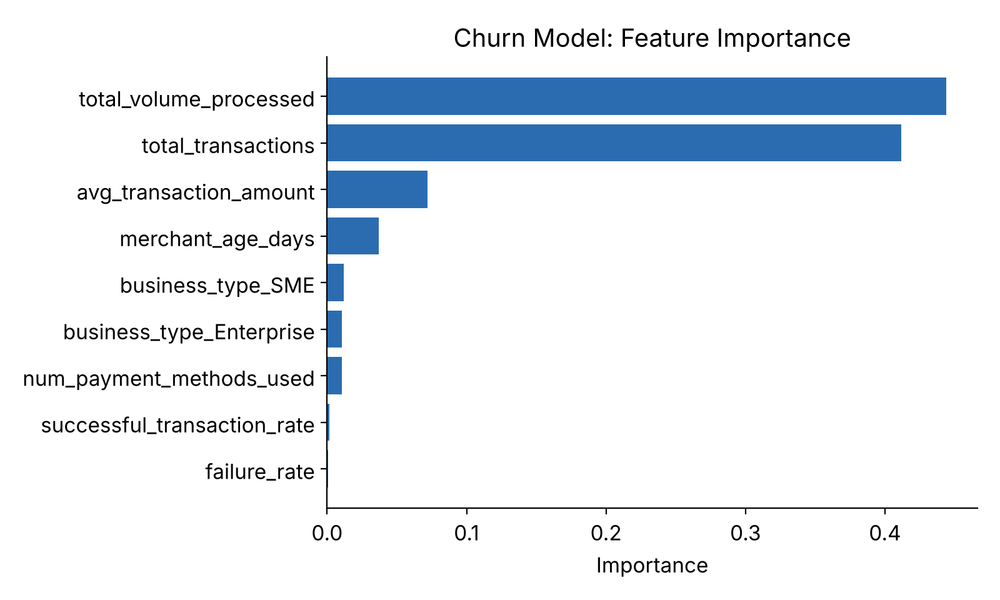
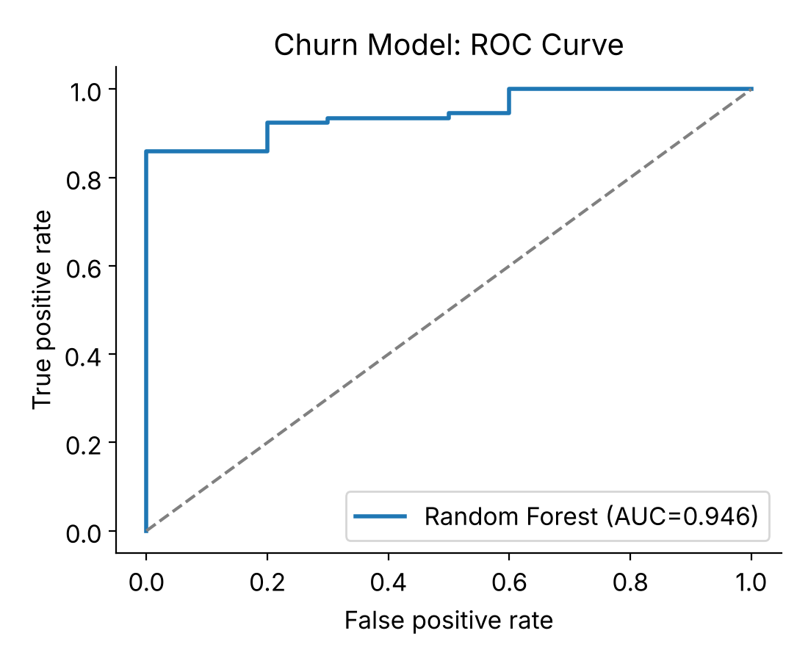
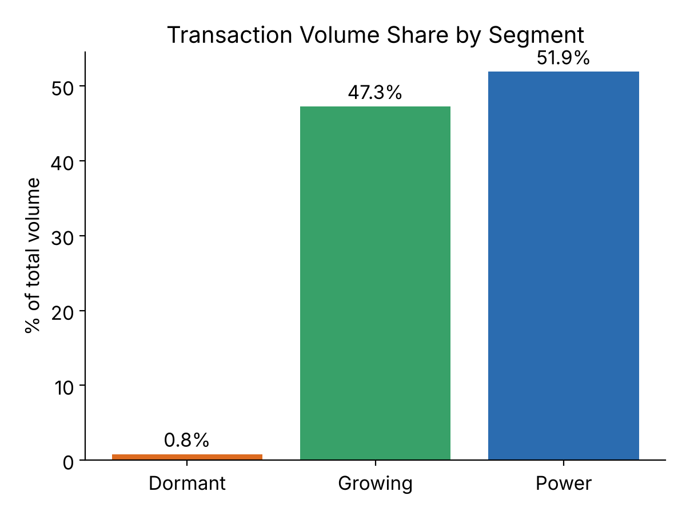
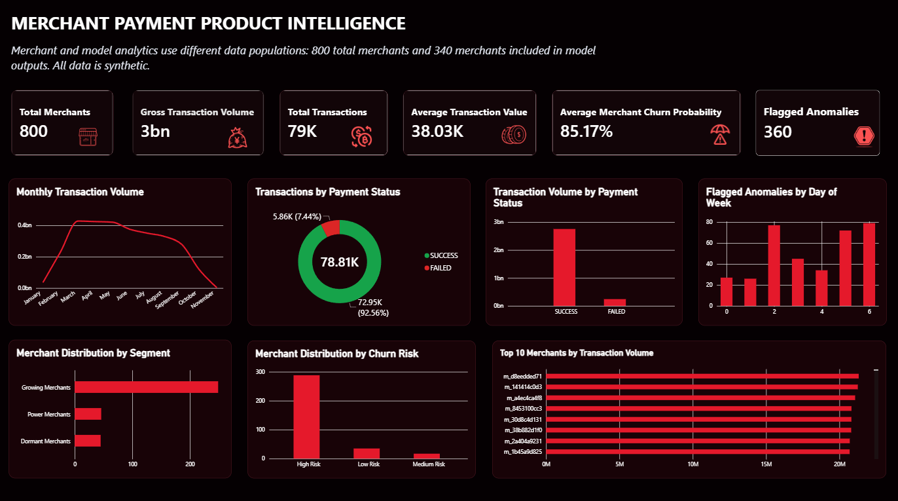

<h1 align="center">Merchant Payment Product Intelligence</h1>


<p align="center">
  
</p>

**End-to-End Fintech Product Analytics | SQL | Python | Machine Learning | Power BI**

An end-to-end fintech product analytics project simulating a Paystack-style payment platform. This project explores merchant onboarding, payment performance, engagement, retention, transaction anomalies, and merchant segmentation using SQL, Python, machine learning, and Power BI.

The objective is to demonstrate how data analytics and machine learning can transform transactional data into meaningful business insights and support data-driven product decisions.

> **Data Disclaimer:** All datasets are synthetic and generated using `python_scripts/Data_Ingestion.py`. No real merchant, customer, or payment information is used. All findings represent simulated business behaviour, not the performance of an actual payment company.

---

## Table of Contents

- [Project Overview](#project-overview)
- [Business Objectives](#business-objectives)
- [Dataset Overview](#dataset-overview)
- [Technology Stack](#technology-stack)
- [Project Architecture](#project-architecture)
- [SQL Analytics](#sql-analytics)
- [Machine Learning Models](#machine-learning-models)
- [Key Business Insights](#key-business-insights)
- [Visualization Gallery](#visualization-gallery)
- [Power BI Reporting](#power-bi-reporting)
- [Project Structure](#project-structure)
- [Getting Started](#getting-started)
- [Limitations](#limitations)
- [Future Improvements](#future-improvements)
- [Developed By](#developed-by)
- [License](#license)

---

## Project Overview

Payment platforms generate large volumes of transactional and merchant activity data. Understanding this information is essential for improving merchant onboarding, payment success rates, retention, and overall platform performance.

This project builds a simulated fintech analytics environment to investigate these areas through:

- Relational database design and SQL analytics.
- Merchant onboarding and activation analysis.
- Payment performance and transaction trends.
- Merchant retention and churn analysis.
- Transaction anomaly detection.
- Merchant segmentation using unsupervised learning.
- Interactive business intelligence reporting.

The project combines analytical SQL workflows with machine learning models to demonstrate an end-to-end approach to fintech product intelligence.

## Business Objectives

The project addresses six major business questions.

| Business Area | Business Question |
|---|---|
| Merchant Onboarding | How many registered merchants successfully process their first live payment? |
| Merchant Engagement | How actively are merchants using the payment platform? |
| Payment Performance | Which payment methods have the highest transaction success rates? |
| Merchant Retention | Which merchants exhibit signs of inactivity or churn? |
| Transaction Risk | Which transactions demonstrate unusual behavioural patterns? |
| Merchant Segmentation | Which merchants contribute most to payment volume? |

---

## Dataset Overview

The project uses synthetic datasets generated through Python.

### Raw Datasets

| Dataset | Records | Description |
|---|---:|---|
| Merchants | 800 | Merchant registration and business information |
| Transactions | 78,810 | Payment transaction records |
| API Keys | 1,149 | Merchant API key information |
| Merchant Onboarding | 800 | Merchant onboarding and activation information |

### Processed Datasets

| Dataset | Description |
|---|---|
| Churn Model | Merchant-level churn modelling features |
| Fraud Model | Transaction-level anomaly detection features |
| Merchant Segmentation | Merchant behavioural segmentation features |

### Transaction Overview

| Metric | Value |
|---|---:|
| Total Transactions | 78,810 |
| Live Transactions | 73,192 |
| Test Transactions | 5,618 |
| Live Transaction Success Rate | 91.99% |
| Currency | NGN |
| Data Period | 3 January 2024 – 13 November 2024 |
| Successful Live GMV | Approximately ₦2.75 billion |

**GMV (Gross Merchandise Value)** represents the value of successfully processed live transactions. It should not be interpreted as the payment platform's revenue.

### Dataset Characteristics

- 800 synthetic merchants.
- Approximately 50.1% Enterprise and 49.9% SME merchants.
- Three payment methods: Bank, USSD, and Card.
- Both TEST and LIVE transaction environments.
- Successful and failed transaction records.
- Synthetic transaction failure reasons.

---

## Technology Stack

| Category | Technologies |
|---|---|
| Programming | Python |
| Database | Microsoft SQL Server |
| Data Analysis | Pandas, NumPy |
| Machine Learning | Scikit-learn |
| Data Visualization | Matplotlib, Seaborn |
| Business Intelligence | Microsoft Power BI |
| Development Environment | Visual Studio Code, Jupyter Notebook |
| Version Control | Git, GitHub |

---

## Project Architecture

The project follows an end-to-end analytics workflow.

```text
              SYNTHETIC DATA GENERATION
                       Python
                         |
                         v
                  RAW CSV DATASETS
                         |
          +--------------+--------------+
          |              |              |
          v              v              v
       Merchants      API Keys     Transactions
          |              |              |
          +--------------+--------------+
                         |
                         v
                 RELATIONAL DATABASE
                 Microsoft SQL Server
                         |
                         v
                    SQL ANALYTICS
                         |
          +--------------+--------------+
          |              |              |
          v              v              v
      Onboarding     Engagement     Retention
          |              |              |
          +--------------+--------------+
                         |
                         v
                  PYTHON ANALYTICS
                         |
          +--------------+--------------+
          |              |              |
          v              v              v
     Churn Model    Anomaly Model   Segmentation
          |              |              |
          +--------------+--------------+
                         |
                         v
                RESULTS & INSIGHTS
                         |
                         v
                    POWER BI
               INTERACTIVE REPORTING
```

### Database Design

The relational database contains three core entities:

- `merchants`
- `api_keys`
- `transactions`

Analytical views support merchant onboarding, activity, and lifecycle analysis.

### Entity Relationship Diagram



---

## SQL Analytics

SQL is used to investigate merchant behaviour, payment performance, and product engagement.

### 1. Merchant Onboarding

Key metrics:

- Total registered merchants.
- Activated merchants.
- Merchant activation rate.
- Time from registration to first successful live transaction.
- Merchant activation trends.

**Activation Definition:** A merchant is considered activated when they complete at least one successful LIVE transaction.

### 2. Payment Performance

Analyses include:

- Transaction success and failure rates.
- Payment method distribution.
- Payment failure reasons.
- Daily and monthly transaction trends.
- Monthly live GMV.
- Average transaction amount.

### Payment Method Performance

| Payment Method | Share of Live Transactions | Success Rate |
|---|---:|---:|
| Bank | 33.5% | 91.96% |
| USSD | 33.3% | 92.14% |
| Card | 33.2% | 91.86% |

The payment methods show a relatively balanced transaction distribution and similar success rates.

### Leading Failure Reasons

| Failure Reason | Transactions |
|---|---:|
| Insufficient Funds | 1,544 |
| Invalid Card | 1,514 |
| Bank Timeout | 1,429 |
| Network Error | 1,377 |

### 3. Merchant Engagement and Retention

Analyses include:

- Merchant transaction frequency.
- Merchant payment volume.
- Last successful transaction.
- Merchant activity trends.
- Merchant inactivity.
- Retention and churn patterns.

The project distinguishes retrospective merchant inactivity from forward-looking churn prediction.

---

## Machine Learning Models

Three machine learning workflows investigate different aspects of merchant and transaction behaviour.

### 1. Merchant Churn Prediction

**Algorithm:** Random Forest Classifier

**Objective:** Identify merchants exhibiting characteristics associated with churn.

The model uses merchant-level historical information to estimate churn risk.

#### Model Evaluation

Held-out test set: 102 merchants.

| Evaluation Metric | Result |
|---|---:|
| Accuracy | 85.29% |
| Balanced Accuracy | 82.93% |
| Precision | 97.53% |
| Recall | 85.87% |
| F1 Score | 91.33% |
| ROC-AUC | 94.57% |
| PR-AUC | 99.41% |

#### Confusion Matrix

| Actual / Predicted | Retained | Churned |
|---|---:|---:|
| Retained | 8 | 2 |
| Churned | 13 | 79 |

#### Important Features

| Feature | Importance |
|---|---:|
| Total Volume Processed | 44.41% |
| Total Transactions | 41.17% |
| Average Transaction Amount | 7.20% |
| Merchant Age | 3.68% |

The model relies heavily on historical transaction volume and transaction counts.

**Important:** Feature importance describes the fitted model; it does not establish causal churn drivers. The synthetic churn-label construction and historical observation windows may introduce leakage or history-length bias.

### 2. Transaction Anomaly Detection

**Algorithm:** Isolation Forest

**Objective:** Identify unusual transaction patterns that may require further investigation.

Features include:

- Transaction amount.
- Merchant average transaction amount.
- Transaction timing.
- Merchant transaction history.
- Merchant failure rate.
- Rapid repeat transactions.
- Transaction burst patterns.
- Merchant lifecycle information.

#### Model Results

| Metric | Result |
|---|---:|
| Transactions Analysed | 17,962 |
| Configured Contamination | 2% |
| Flagged Anomalies | 360 |
| BLOCK | 1 |
| REVIEW | 42 |
| APPROVE | 317 |

The Isolation Forest model identifies statistically unusual transactions.

**Important:** Model-flagged anomalies are not confirmed fraudulent transactions. The generated actions are heuristic classifications and require further investigation.

### 3. Merchant Segmentation

**Algorithm:** K-Means Clustering

**Number of Clusters:** 3

**Objective:** Group merchants according to their transaction and business performance characteristics.

Features include:

- Total transaction volume.
- Average transaction size.
- Transaction frequency.
- Average monthly transactions.
- Payment method diversity.
- Transaction success rate.
- Merchant age.

#### Segmentation Results

| Segment | Merchants | Average Volume | Share of Total Volume |
|---|---:|---:|---:|
| Power | 46 | ₦8.27M | 51.9% |
| Growing | 249 | ₦1.39M | 47.3% |
| Dormant | 45 | ₦132K | 0.8% |

Segment names are descriptive labels assigned to the resulting clusters.

---

## Key Business Insights

The synthetic analysis produces several observations.

### 1. Merchant Activation

Merchant registration does not necessarily translate into successful payment processing. Tracking the first successful LIVE transaction helps distinguish registered merchants from activated merchants.

### 2. Payment Performance

Bank, USSD, and Card transactions show comparable success rates in the simulation. No payment method demonstrates a substantial success-rate advantage.

### 3. Payment Failure Analysis

Insufficient funds, invalid card details, bank timeouts, and network errors are the leading simulated failure categories.

These categories could inform payment experience improvements and failure-recovery strategies.

### 4. Merchant Volume Concentration

The Power segment contains only 46 merchants but contributes 51.9% of total payment volume.

This indicates substantial simulated GMV concentration among a relatively small group of merchants.

### 5. Churn Risk

Transaction volume and transaction counts are the most influential features in the churn model.

Further temporal validation is necessary before interpreting these relationships as reliable future churn signals.

---

## Visualization Gallery

### Payment Performance

**Payment Success Rate**


**Monthly Gross Merchandise Value**


**Payment Failure Reasons**



### Transaction Anomaly Detection

**Anomaly Overview**


**Flagged vs Normal Transactions**



### Merchant Churn Analysis

**Churn Risk Levels**


**Feature Importance**



**ROC Curve**



### Merchant Segmentation

**Merchant Behavioural Segments**


**Transaction Volume Share by Segment**



---

## Power BI Reporting

An interactive Power BI dashboard brings the analytical outputs together into a business-focused reporting experience.

The dashboard includes:

- Total merchants.
- Total transaction volume.
- Total transactions.
- Average transaction value.
- Average merchant churn probability.
- Model-flagged anomalies.
- Monthly transaction volume.
- Transactions by payment status.
- Transaction volume by payment status.
- Merchant distribution by segment.
- Merchant distribution by churn risk.
- Top merchants by transaction volume.
- Model-flagged anomalies by day of the week.

The dashboard is designed to provide an executive-level overview of merchant activity, payment performance, and transaction risk.

The Power BI report file is available in:

`powerbi_dashboard/Merchant-Payment-Product-Intelligence-Dashboard.pbix`

---

## Project Structure

```text
Merchant-Payment-Product-Intelligence/
│
├── data/
│   ├── raw/
│   │   ├── api keys.csv
│   │   ├── merchant onboarding.csv
│   │   ├── merchants.csv
│   │   └── transactions.csv
│   │
│   └── processed/
│       ├── Churn model.csv
│       ├── Fraud Model.csv
│       └── Merchant Segmentation.csv
│
├── images/
│   ├── Neon Merchant Intelligence Dashboard Animation.gif
│   ├── dashboard.png
│   ├── db_erd.png
│   ├── result_churn_confusion_matrix.png
│   ├── result_churn_feature_importance.png
│   ├── result_churn_risk_levels.png
│   ├── result_churn_roc_curve.png
│   ├── result_failure_reasons.png
│   ├── result_fraud_anomaly_overview.png
│   ├── result_fraud_flagged_vs_normal.png
│   ├── result_monthly_gmv.png
│   ├── result_payment_success_rate.png
│   ├── result_segments_scatter.png
│   └── result_segments_volume_share.png
│
├── notebooks/
│   ├── Churn_Prediction.ipynb
│   ├── Data_Ingestion.ipynb
│   ├── Fraud_Detection.ipynb
│   └── Merchant_Segmentation.ipynb
│
├── powerbi_dashboard/
│   ├── dashboard.png
│   └── Merchant-Payment-Product-Intelligence-Dashboard.pbix
│
├── python_scripts/
│   ├── Churn_Prediction.py
│   ├── Data_Ingestion.py
│   ├── Fraud_Detection.py
│   └── Merchant_Segmentation.py
│
├── results/
│   ├── churn_feature_importance.csv
│   ├── churn_model_metrics.csv
│   ├── churn_predictions_with_risk.csv
│   ├── churn_test_predictions.csv
│   ├── fraud_alert.csv
│   ├── high_risk_transactions.csv
│   └── merchants_with_segments.csv
│
├── sql_scripts/
│   ├── Analytics.sql
│   └── Tables.sql
│
├── LICENSE
├── Merchant-Payment-Product-Intelligence-Dashboard.pbix
└── README.md
```

---

## Getting Started

### Prerequisites

- Python 3.10 or later.
- Microsoft SQL Server.
- Visual Studio Code or Jupyter Notebook.
- Git.

### 1. Clone the Repository

```bash
git clone https://github.com/sreeragsrinu/Merchant-Payment-Product-Intelligence.git

cd Merchant-Payment-Product-Intelligence
```

### 2. Install Python Dependencies

```bash
pip install pandas numpy scikit-learn matplotlib seaborn
```

### 3. Generate Synthetic Data

```bash
python python_scripts/Data_Ingestion.py
```

This generates the raw merchant, API key, and transaction datasets.

### 4. Set Up the Database

Execute:

```text
sql_scripts/Tables.sql
```

This creates the database schema and analytical views in Microsoft SQL Server.

Import the generated CSV datasets into their corresponding database tables.

### 5. Execute SQL Analytics

Run the queries in:

```text
sql_scripts/Analytics.sql
```

### 6. Run the Machine Learning Scripts

```bash
python python_scripts/Churn_Prediction.py

python python_scripts/Fraud_Detection.py

python python_scripts/Merchant_Segmentation.py
```

The scripts generate model outputs, analytical CSV files, and visualizations in the corresponding project directories.

### 7. Open the Power BI Dashboard

Open:

```text
powerbi_dashboard/Merchant-Payment-Product-Intelligence-Dashboard.pbix
```

Use Power BI Desktop to explore the interactive report. Update data-source paths if necessary when opening the project on another computer.

---

## Limitations

- All data is synthetic and does not represent a real payment platform.
- Synthetic transaction patterns may not reflect real-world payment behaviour.
- The churn dataset contains a limited number of merchant records.
- Churn model results require further validation using a properly time-separated evaluation strategy.
- Isolation Forest identifies unusual observations, not confirmed fraud.
- The anomaly contamination setting is a modelling parameter, not an estimate of the real fraud rate.
- Transaction volume and GMV should not be interpreted as platform revenue.
- Actual payment processing fees and operating costs are not included in the datasets.

---

## Future Improvements

- Develop time-based churn prediction and validation.
- Improve merchant activation and retention cohort analysis.
- Add merchant lifetime value modelling.
- Introduce SHAP-based model explainability.
- Improve anomaly detection with additional behavioural features.
- Add automated data quality checks.
- Build a reproducible end-to-end data pipeline.
- Extend the Power BI report with more detailed product and operational metrics.

---

# Power BI Dashboard



## License

This project is licensed under the MIT License. See the [LICENSE](LICENSE) file for details.

Copyright © 2026 Sree.

All datasets are synthetic and generated for educational and portfolio demonstration purposes. No real merchant, customer, or payment information is included.

---

## Developed By

SREERAG 
BCA Data Science Graduate

- **GitHub:** [@sreeragsrinu](https://github.com/sreeragsrinu)
- **LinkedIn:** [Sreerag S](https://www.linkedin.com/in/sreerag-s-9b25162a7/)
- **Portfolio:** [sreeragportfolio.netlify.app](https://sreeragportfolio.netlify.app)
- **Email:** [sreeragsrinuu@gmail.com](sreeragsrinuu@gmail.com)

---
